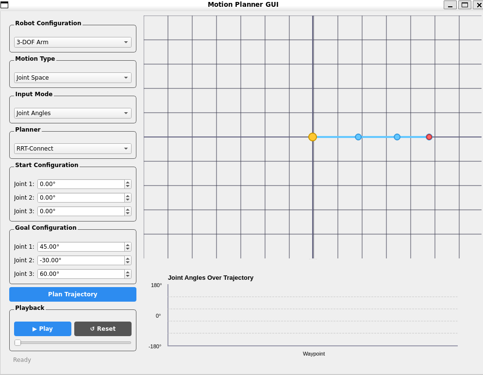
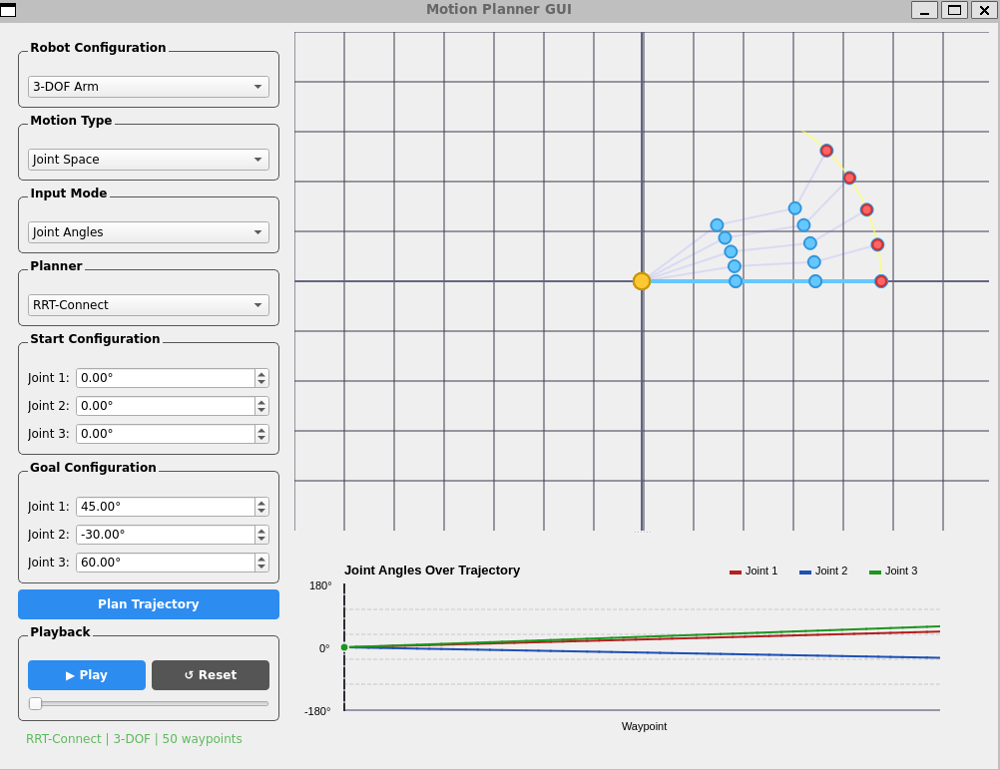
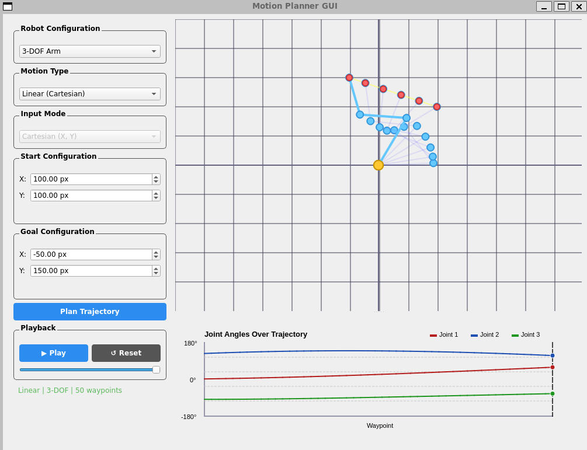
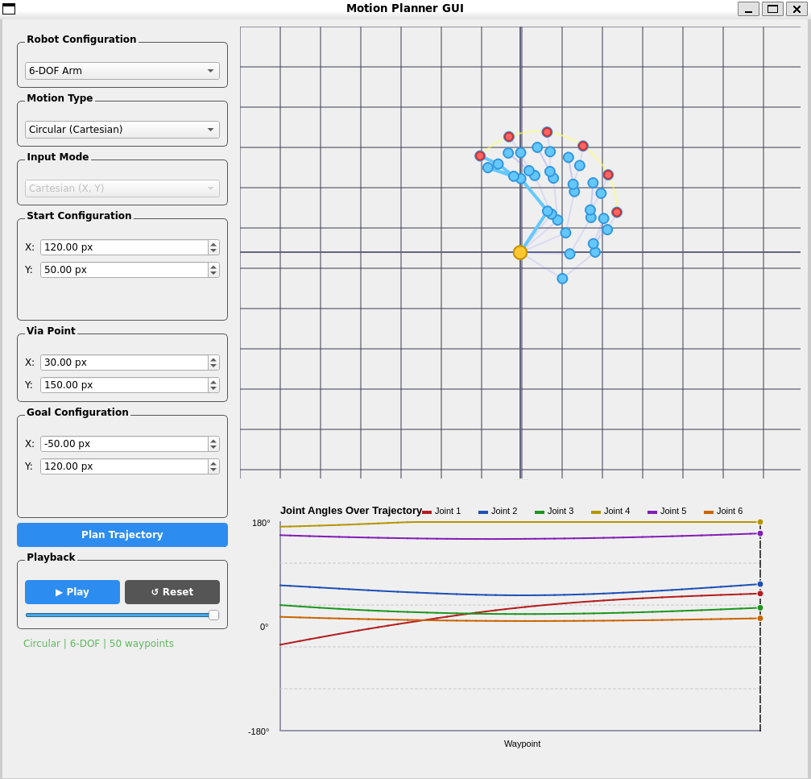

# Motion Planner GUI

A C++ desktop application for visualizing and validating robot arm motion planning, built with **Qt6**, **OMPL** (Open Motion Planning Library), and **Eigen**.

This project implements an MVC (Model-View-Controller) architecture to provide an interactive GUI for planning and visualizing trajectories of a 2D planar robot arm with configurable degrees of freedom.



## Features

### Motion Planning
- **Joint Space Planning** — Uses OMPL sampling-based planners to find collision-free paths in joint configuration space
- **Linear Cartesian Motion** — End effector follows a straight-line path between start and goal positions using numerical inverse kinematics
- **Circular Cartesian Motion** — End effector follows a circular arc through a user-defined via point, with automatic circle fitting

### Multiple Planners
- RRT (Rapidly-exploring Random Tree)
- RRT-Connect (Bidirectional RRT)
- RRT* (Optimal RRT)
- PRM (Probabilistic Roadmap)

### Configurable Robot
- Support for 2-DOF to 6-DOF planar robot arms
- Dynamic joint input fields that update based on selected DOF
- Joint angle and Cartesian (X, Y) input modes
- Automatic inverse kinematics for Cartesian inputs

### Dual Visualization
- **Arm View** — Real-time 2D visualization of the robot arm with ghost trajectory, end-effector path trace, and color-coded joints
- **Joint Plot** — Synchronized graph showing joint angle curves over the trajectory with current frame indicator

### Trajectory Playback
- Play/Pause animation with adjustable frame slider
- Reset to start position
- Synchronized arm view and joint angle plot

### Input Validation
- Reachability checks before trajectory execution
- Clear error messages for unreachable positions
- Joint limit enforcement
- Collinearity detection for circular motion

## Architecture

The project follows the **Model-View-Controller (MVC)** pattern:

```
src/
├── main.cpp
├── model/
│   ├── RobotModel.h/.cpp          # Robot kinematics, FK, IK, joint limits
│   ├── PlannerWrapper.h/.cpp       # OMPL planner integration
│   └── TrajectoryGenerator.h/.cpp  # Linear and circular trajectory generation
├── view/
│   ├── ControlPanel.h/.cpp         # Input controls, dropdowns, playback buttons
│   ├── VisualizationWidget.h/.cpp  # 2D robot arm rendering with QPainter
│   └── JointPlotWidget.h/.cpp      # Joint angle plot over trajectory
└── controller/
    └── PlannerController.h/.cpp    # Connects inputs to planning and visualization
```

## Dependencies

- **Qt6** (Widgets)
- **OMPL 2.0+** (Open Motion Planning Library)
- **Eigen3** (Linear algebra)
- **CMake 3.16+**
- **C++17** compiler

## Build

Install dependencies (Ubuntu/Debian):

```bash
sudo apt install -y build-essential cmake qt6-base-dev libqt6widgets6 \
    libgl1-mesa-dev libvulkan-dev libeigen3-dev libboost-all-dev libode-dev
```

Build OMPL from source:

```bash
git clone https://github.com/ompl/ompl.git
cd ompl && mkdir build && cd build
cmake .. -DOMPL_BUILD_DEMOS=OFF
make -j$(nproc)
sudo make install
sudo ldconfig
cd ../..
```

Build the project:

```bash
git clone https://github.com/YOUR_USERNAME/motion-planner-gui.git
cd motion-planner-gui
mkdir build && cd build
cmake ..
make
./MotionPlannerGUI
```

## Usage

1. **Select Robot DOF** — Choose between 2-DOF and 6-DOF arm configurations
2. **Choose Motion Type** — Joint Space (OMPL planning), Linear, or Circular
3. **Set Start and Goal** — Enter joint angles or Cartesian coordinates
4. **Select Planner** — For Joint Space mode, choose RRT, RRT-Connect, RRT*, or PRM
5. **Plan Trajectory** — Click "Plan Trajectory" to compute the path
6. **Playback** — Use Play/Pause/Reset and the slider to animate the trajectory

### Example Inputs

| Motion Type | Start | Goal | Via Point |
|-------------|-------|------|-----------|
| Joint Space | (0, 0, 0) | (45, -30, 60) | - |
| Linear | (150, 50) | (50, 150) | - |
| Circular | (120, 50) | (-50, 120) | (30, 150) |

## Screenshots

### Joint Space Planning with RRT-Connect


### Linear Cartesian Motion


### Circular Cartesian Motion


## License

MIT License
